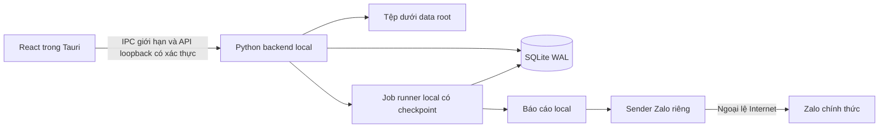

# Kiến trúc cafe_fin phiên bản đầu

## Quyết định nền tảng

Một PC, một người nhập, dữ liệu mới và yêu cầu cài gọn cho phép dùng schema desktop mới thay kiến trúc Docker/Redis/MinIO của CRM cũ. Chọn hướng Tauri 2 + React 19/TypeScript/Ant Design/TanStack React Query/Zustand, Python 3.12 FastAPI + SQLAlchemy 2 + SQLite WAL và tệp local. Không chuyển sang Vue/Pinia theo chữ trong ảnh tham khảo.

Foundation phải thử đóng gói Python sidecar, PDF tiếng Việt, runtime WebView2 và grid miễn phí trước khi đóng băng baseline. Nếu gặp lỗi tương thích có bằng chứng, điều phối điều chỉnh ADR và các prompt trước khi cho module chạy; không để từng lane tự đổi stack.

SQLite phù hợp lưu trữ ứng dụng local, nhưng WAL chỉ có một writer. Một triệu dòng không tự yêu cầu database server; cần index, truy vấn phân trang và benchmark. DB hoạt động ở ổ local, không SMB/OneDrive sync. Không chạy lại chain Alembic PostgreSQL, trigger PL/pgSQL hoặc advisory locks từ repo cũ trên SQLite. [SQLite](https://www.sqlite.org/whentouse.html), [WAL](https://www.sqlite.org/wal.html).

## Tiến trình và lưu trữ



Core bind loopback, token phiên được tạo khi launch và không nằm trong URL/log. Tauri chỉ mở chức năng file và shell đã allowlist; không cung cấp tùy ý đọc đĩa hoặc chạy lệnh cho frontend. Có single-instance, quản lý lifecycle sidecar và release lock khi thoát/crash. Không dựa vào `navigator.onLine` để quyết định API localhost mất kết nối.

Tauri có thể nhúng binary sidecar và bộ cài Windows; cần dùng quy trình build thực tế để kiểm phụ thuộc, không coi tài liệu là bằng chứng bộ cài đã đạt. [Sidecar](https://v2.tauri.app/develop/sidecar/), [Windows installer](https://v2.tauri.app/distribute/windows-installer/).

## Tổ chức mã

```text
backend/cafe_fin/core/           DB, auth, file store, jobs, backup services, common types
backend/cafe_fin/records/        Đối tác, hàng, cân, nhật ký, stock ledger
backend/cafe_fin/contracts/      Soạn và xuất hợp đồng/chứng từ
backend/cafe_fin/accounting/     Sổ, staging, validation, formulas, import/export
backend/cafe_fin/reporting/      Báo cáo, lịch và sender Zalo
frontend/src/app/                Shell, routing và module registry
frontend/src/shared/             API client, common widgets, primitives
frontend/src/features/<module>/  UI từng lane
desktop/                        Tauri và đóng gói sidecar
tests/<module>/                 Tests theo chủ sở hữu
docs/prompts/                   Prompt giao việc
```

Module export registration công khai; foundation tạo registry và typed interfaces để lane không cùng sửa App/main/schema. Mỗi module sở hữu migrations và bảng có prefix riêng; foundation sở hữu migration runner/version table. Không một file models.py chung chứa toàn bộ domain.

## Ghi dữ liệu và độ chính xác

- Writer coordinator xếp hàng các write transaction ngắn; không giữ transaction trong lúc parse file, chờ người sửa hoặc gọi Zalo.
- Các mutation có version, request key và audit trước/sau. Một request key cùng payload trả kết quả đã có; payload khác trả conflict.
- Tiền JSON là Decimal string; chuẩn bản đầu VND với precision tối đa hai chữ số thập phân, DB lưu integer đơn vị 0,01 VND, có kiểm miền int64 trước ghi. VND hiển thị không ép hai số lẻ nếu không cần. Kg lưu integer 0,001 kg; không float. Import không lặng lẽ làm tròn dữ liệu nhiều precision; yêu cầu sửa hoặc lựa chọn làm tròn có ghi nhận.
- Ngày giao dịch local và timestamp UTC là hai trường khác nhau. Báo cáo dùng khoảng giờ Việt Nam. ID ổn định UUID string.
- Stock update kiểm toàn bộ phạm vi ảnh hưởng trong cùng transaction của mutation, kể cả backdate/edit/delete. Có index phù hợp và thứ tự sự kiện xác định; không chỉ kiểm một SELECT trước khi transaction ghi.

## Import và grid

XLSX/XLSM đọc tuần tự bằng reader đã kiểm tra; CSV iterator. Tệp gốc bất biến, staging riêng, patches riêng, mỗi trang/range tải hữu hạn. Job parse/validate/dedup/commit tách nhau và có checkpoint.

SQLite commit theo chunk với marker, counts và source-row identity trong cùng transaction vào attempt pending. Mỗi lần confirm tạo snapshot staging/mapping bất biến hoặc copy-on-write; sửa dòng lỗi cho lượt sau không đổi input attempt đang chạy. Chỉ công bố attempt sau khi đủ tập đã xác nhận bằng một transaction ngắn; mọi truy vấn sổ/CRUD/báo cáo dùng visibility predicate chung để không lộ pending. UI tách staged_committed_rows và published_rows. Tránh writer monopolization bằng batch size/backpressure đo thực tế; cancellation dừng ở ranh giới an toàn. Không tăng tốc bằng tắt durability hoặc bỏ constraint trên dữ liệu thật.

Không trả toàn bộ issue/duplicate IDs của triệu dòng trong một response; dùng paging và selection manifest phía server. Checkpoint XLSX không mặc định seek O(1): có thể phải đọc lại và skip trước mốc hoặc hoàn tất staging rồi resume phase sau. Kiểm dung lượng raw+staging+pending+indexes+WAL trước import, và dùng Decimal/check khi SUM integer có thể vượt int64.

Grid miễn phí ứng viên là Glide Data Grid (MIT) hoặc thay thế tương đương sau spike React compatibility. Grid không phải workbook engine; cần service công thức giới hạn, có dependencies, cycle detection và range limits. Có thể đánh giá parser MIT như fast-formula-parser; việc chọn/pin sau kiểm giấy phép, phụ thuộc và tính chính xác, không chạy eval. Không tự chọn HyperFormula GPL/commercial hoặc Handsontable/AG Enterprise mà chưa giải quyết điều kiện license. [Glide source/license](https://github.com/glideapps/glide-data-grid), [Parser source/license](https://github.com/LesterLyu/fast-formula-parser).

Không tuyên bố giữ VBA hoặc mọi Excel feature sau parse/resave: chỉ bản gốc được bảo toàn byte. Export projection có nhãn tệp dẫn xuất, xử lý text bắt đầu bằng ký tự công thức mà không làm sai số âm numeric. Không tự thực thi formula ngoài danh sách hoặc external reference. [VBA web](https://support.microsoft.com/en-us/excel/work-with-vba-macros-in-excel-for-the-web), [openpyxl optimized](https://openpyxl.readthedocs.io/en/stable/optimized.html).

## Sao lưu và gửi báo cáo

Core cung cấp dịch vụ backup/restore data root có manifest/hash và snapshot DB bằng API phù hợp, không copy riêng file `.db` khi WAL đang hoạt động. Backup không tự có giá trị nếu chưa restore thử. Chuyển data root dùng khóa độc quyền, copy+verify rồi đổi cấu hình; không xóa nguồn trước xác minh.

Reporting đọc snapshot/DTO của records/accounting, không import private ORM để sửa dữ liệu module khác. Sender chỉ đọc payload được chọn gửi; credential trong kho bí mật của OS, không Git/URL/log/report. Mạng ngoài phục vụ token/upload/send/receipt Zalo; core không có crawler/OAuth/cloud inference.

Không dựng webhook public hoặc mở cổng DB/MinIO/CRM. Lịch vận hành local có cấu hình timezone và catch-up; thiếu credential/nhóm/lịch hiện trạng thái rõ, không bịa gửi thành công. Cần xác minh kênh Zalo GMF/OA hoặc Bot nhóm khả dụng bằng API chính thức trước thử gửi thật.

## Gate foundation

Foundation bàn giao đủ cấu trúc và interfaces, migrations mới, app launch, chọn data root, local auth, job test ngắt/tiếp tục, API paging/error/version/idempotency, grid spike, Word/PDF spike và smoke bộ cài Windows. Điều phối review rồi tạo tag `cafe-fin-foundation-ready-v1`; chưa có tag thì các module chưa bắt đầu.

Bộ cài hoàn chỉnh chỉ nghiệm thu sau các module được tích hợp; tag foundation không có nghĩa tính năng nghiệp vụ hoặc benchmark một triệu dòng đã hoàn tất.
